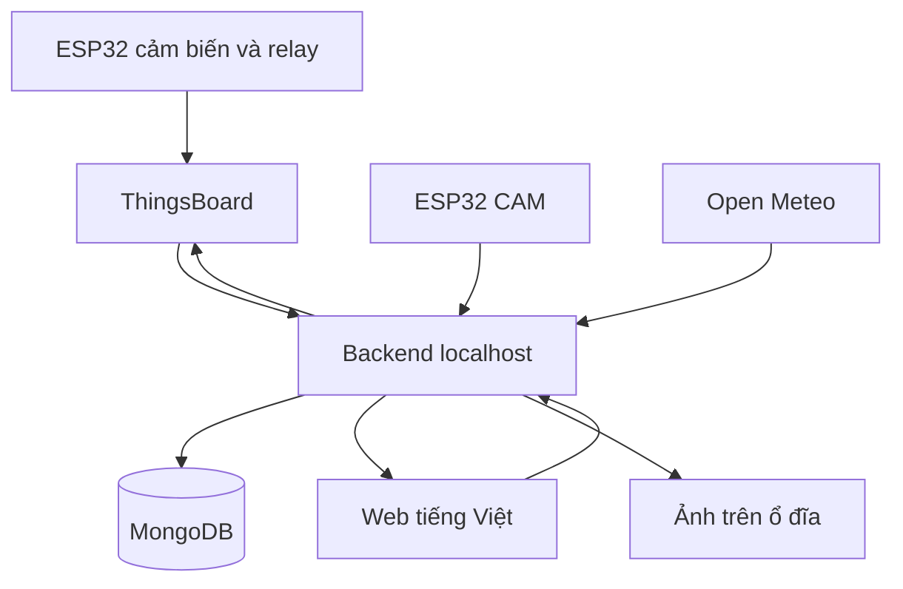
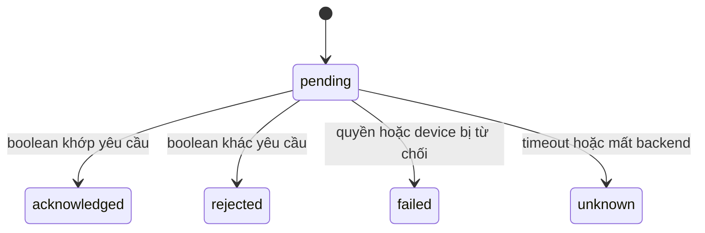

# Thiết kế MongoDB cho AoTom Nexus

Thiết kế giữ dữ liệu đo gốc, phản hồi điều khiển và nguồn gốc dữ liệu học máy trong các collection độc lập. Bản web hiện thực một ao / một bộ điều khiển; các khóa `pondId`, `deviceId`, `cameraId` là điểm mở rộng cho nhiều ao và thiết bị. Thời gian lưu BSON Date theo UTC, giao diện chuyển sang giờ Việt Nam. Định danh dùng string ổn định (`pond-01`, `esp32-01`) hoặc UUID string; không trộn kiểu string với ObjectId cho cùng một khóa.

## Luồng hiện tại



Đường điều khiển chạy ngược từ web qua backend, RPC ThingsBoard tới ESP32. Không truy cập MongoDB hoặc lưu JWT ThingsBoard ở trình duyệt. Không có kết nối trực tiếp từ ThingsBoard Cloud tới localhost: backend chủ động kéo dữ liệu nên không cần mở cổng Internet.

## Các collections và mức hiện thực

`npm run db:init` tạo đầy đủ 19 collections và indexes. “Dự phòng” nghĩa là collection đã có nhưng chưa có workflow/UI sử dụng; không có pipeline giả.

| Collection | Khóa và nội dung chính | Mức hiện thực |
| --- | --- | --- |
| `ponds` | `_id`, `slug`, `name`, vị trí dự phòng, metadata | Khởi tạo ao; tên đang chỉnh trong `settings` |
| `devices` | `_id`, `pondId`, `externalId` UUID ThingsBoard, `type`, `provider` | Khởi tạo ESP32; quản lý nhiều thiết bị dự phòng |
| `sensors` | `deviceId`, `metric`, `unit`, `gpio`, `calibrationVersion` | Khởi tạo 4 cảm biến, chưa UI hiệu chuẩn |
| `measurements` | `pondId`, `deviceId`, `metric`, `value`, `unit`, `observedAt`, `receivedAt`, `quality`, `source`, `schemaVersion` | Đồng bộ và đọc lịch sử |
| `ingestion_state` | `deviceId`, `metric`, `throughTs` milliseconds UTC, `updatedAt` | Cursor nhập bù theo từng key |
| `commands` | `pondId`, `deviceId`, `method`, `requestedValue`, `status`, `idempotencyKey`, phản hồi và thời điểm | Gửi RPC và ghi nhật ký |
| `alerts` | `pondId`, `key`, `kind`, `severity`, `active`, `detail`, vòng đời, người xác nhận | Cảnh báo theo dữ liệu mới và thời tiết |
| `settings` | `_id` bằng pondId, `pondName`, `latitude`, `longitude`, `thresholds`, `weather` | Cấu hình web, không sửa firmware |
| `weather_runs` | `pondId`, `provider`, `fetchedAt`, tọa độ, `hours[]`, `risks[]` | Dự báo 24 giờ lấy theo yêu cầu |
| `media_assets` | `pondId`, `cameraId`, `capturedAt`, `storageKey`, `mimeType`, `sizeBytes`, trạng thái nhãn và inference | Chụp, lưu, xem ảnh |
| `annotations` | `mediaId`, `createdAt`, `authorId`, `objects[]`, `revision` | Dự phòng gán nhãn ảnh |
| `detections` | `mediaId`, `modelVersionId`, `objects[]`, `inferredAt`, `latencyMs` | Dự phòng kết quả detector |
| `datasets` | `name`, `version`, `task`, `manifest`, chia tập, hash và thời điểm chốt | Dự phòng dataset bất biến |
| `training_jobs` | `datasetId`, `algorithm`, `status`, tham số, lỗi, tiến độ, thời điểm | Dự phòng hàng đợi worker |
| `model_versions` | `pondId`, `metric`, `algorithm`, `parameters`, khoảng dữ liệu, đánh giá, phiên bản | Lưu baseline hiện tại |
| `predictions` | `pondId`, `metric`, `modelVersionId`, `issuedAt`, `targetAt`, `value` | Lưu dự báo baseline |
| `audit_logs` | `actorId`, `action`, `createdAt`, thay đổi cấu hình | Ghi thay đổi settings |
| `users` | `email` unique, tên, passwordHash / OIDC subject khi mở rộng | Dự phòng, chưa đăng nhập |
| `memberships` | `userId`, `pondId`, `role` (`viewer`, `operator`, `admin`) | Dự phòng, chưa phân quyền |

Bản đầu không bật auth người dùng vì chỉ bind loopback. Không đưa nguyên bản này lên Internet hay mở cho nhiều người dùng như một sản phẩm đã có phân quyền. Việc mở rộng cần middleware xác thực, kiểm tra quyền theo ao trên mọi query và actor thật thay `local-operator`.

## Vì sao chọn collection thường cho measurements

Mỗi tài liệu lưu **một chỉ số ở một thời điểm gốc**. Các key ThingsBoard có timestamp khác nhau, nên không gộp chúng thành một hàng có timestamp giả tại lúc poll. Unique index dưới đây chống trùng bền vững sau restart và cho phép nhập bù idempotent:

```javascript
db.measurements.createIndex(
  { deviceId: 1, metric: 1, observedAt: 1 },
  { unique: true }
)
db.measurements.createIndex({ pondId: 1, metric: 1, observedAt: -1 })
```

MongoDB time series có lợi về lưu trữ, nhưng không hỗ trợ unique indexes và có giới hạn validator / cập nhật. Bản đầu chọn collection thường để xử lý dedup, schema validation và backfill đơn giản. Khi dữ liệu tăng, có thể bổ sung tầng raw idempotent rồi chuyển sang time series hoặc kho lịch sử; không nên đổi loại collection hiện có trực tiếp. Nguồn: [MongoDB time series limitations](https://www.mongodb.com/docs/manual/core/timeseries/timeseries-limitations/).

### Mẫu dữ liệu đo

```javascript
{
  _id: ObjectId("...") /* MongoDB tự sinh cho measurements */,
  pondId: "pond-01",
  deviceId: "esp32-01",
  metric: "ph",
  value: 7.98,
  unit: "pH",
  observedAt: ISODate("2026-11-16T12:00:00.000Z"),
  receivedAt: ISODate("2026-11-16T12:00:03.000Z"),
  quality: "valid", // valid | missing | invalid
  source: "thingsboard", // demo chỉ có trong RAM
  schemaVersion: 1
}
```

`_id` do MongoDB tự sinh ở `measurements` không phải khóa tham chiếu trong bản này; tính duy nhất nghiệp vụ nằm ở device/metric/thời điểm. Các collection được `Store.insert` tạo có `_id` UUID string. Nếu tạo dataset chứa references tới measurements, chuẩn hóa reference đó riêng hoặc dùng tuple ổn định `{deviceId, metric, observedAt}`.

Với `ph=null` hoặc chuỗi `"null"` trên ThingsBoard, `value=null`, `quality=missing`. Giá trị ngoài phạm vi vật lý được đổi thành null với `quality=invalid`, không dùng huấn luyện. Phiên bản hiện tại chưa lưu nguyên văn giá trị lỗi; nếu cần forensic đầy đủ, thêm `rawValue` vào schema v2. `ph_calibrated` vẫn lưu riêng như một key; khi mở rộng hiệu chuẩn, gắn `calibrationVersion` vào mỗi measurement để truy được công thức, ngày và điểm chuẩn.

| Key | Ý nghĩa | Đơn vị / loại |
| --- | --- | --- |
| `temp` | Nhiệt độ nước DS18B20 | °C |
| `ph` | pH PH-4502C | pH, có thể null |
| `turb` | Độ đục tương đối | %, chưa quy đổi NTU |
| `humidity` | Độ ẩm từ cảm biến tại ao trong tương lai | %, hiện chưa có dữ liệu |
| `laser` | Tia laser bị cắt | 0/1 |
| `pump`, `fan`, `auto` | Trạng thái firmware | 0/1 |
| `alert_level` | Mức cảnh báo do firmware gửi | 0–3 |
| `alerts` | Danh sách cảnh báo dạng chuỗi của firmware | string |
| `ph_calibrated` | Trạng thái hiệu chuẩn trong firmware | 0/1 |

`alert_event` là event riêng chưa nhập vào collection trong bản đầu, luồng Zalo của ThingsBoard vẫn xử lý. Nếu cần thu thập event này, thêm collection `device_events` với `externalEventId` hoặc `(deviceId, observedAt, eventType)` unique, không gộp vào chuỗi sensor.

### Đồng bộ nhập bù

- Lần đầu nhập 24h mặc định, cấu hình được 1–168h. Từng key được đọc theo ASC, `agg=NONE`, tối đa 1000 điểm/trang.
- Ghi dữ liệu xong mới cập nhật cursor riêng từng key. Nếu chết sau ghi trước cập nhật cursor, lần tiếp theo upsert không tạo trùng.
- Mỗi chu kỳ đọc chồng 60 giây với cursor cũ. Timestamp từ ThingsBoard giữ nguyên. Cửa sổ chồng không bảo đảm nhận backdated quá 60 giây.
- Sau gián đoạn dài, cursor trong MongoDB cho phép tiếp tục, với điều kiện ThingsBoard còn giữ dữ liệu lịch sử. Web chỉ thấy dữ liệu đã nhập vào MongoDB.
- Để nhập lại dữ liệu cũ hoặc sửa lỗi giá trị upstream, dừng backend, sao lưu DB; dùng mongosh đặt `ingestion_state.throughTs` về timestamp trước khoảng muốn nhập. Dữ liệu cũ đang dùng `$setOnInsert`, nên đổi giá trị upstream tại cùng timestamp sẽ **không** ghi đè tự động. Cần quy trình correction có audit nếu muốn sửa lịch sử.

```javascript
// Thực hiện thủ công sau sao lưu, dùng timestamp thực tế cần nhập lại.
db.ingestion_state.updateOne(
  { deviceId: "esp32-01", metric: "ph" },
  { $set: { throughTs: ISODate("2026-11-15T00:00:00Z").getTime() } }
)
```

## Nhật ký lệnh và cảnh báo

Một command có `idempotencyKey` unique toàn collection. Trạng thái:



Không coi HTTP request được gửi là thực thi thành công. Gọi RPC hai chiều và kiểm tra boolean theo firmware hiện tại. `unknown` cần đọc lại trạng thái, không tự retry. Các lệnh pending từ tiến trình cũ được chuyển unknown khi backend live khởi động lại. Chỉ chạy một backend cho DB bản đầu; cơ chế claim/lease cho nhiều worker là phần mở rộng.

Mỗi alert có `key` nghiệp vụ (`threshold:ph`, `security:laser`), `active`, `createdAt`, `resolvedAt`, `acknowledgedAt`. Cùng điều kiện đang diễn ra không tạo alert mới mỗi 5 giây. Sau khi trở về bình thường rồi vượt ngưỡng lần nữa, tạo một event mới. Xác nhận đã xem không giải quyết điều kiện vật lý. Cảnh báo thời tiết hiện là thông báo dự báo theo lần lấy, không có vòng đời active như cảm biến. Dữ liệu cảm biến stale có cảnh báo connection riêng.

## Thời tiết và chống rò rỉ tương lai trong ML

Mỗi lần lấy thời tiết lưu một bản `weather_runs` gồm provider, tọa độ, `fetchedAt` và tối đa 24 giờ trong `hours[]`. Mỗi giờ có `targetAt`, `airTemp`, `humidity`, `rain`, `rainProbability`, `wind`. Không ghi thời tiết vào `measurements` của cảm biến ao.

Mô hình tương lai cần phân biệt **thời điểm biết dự báo** (`fetchedAt`) với **thời điểm dự báo hướng tới** (`targetAt`). Khi backtest tại t, chỉ dùng weather run đã có `fetchedAt <= t`, không dùng bản dự báo mới lấy hôm nay cho các ngày quá khứ. Nếu API có thời điểm phát hành model đáng tin cậy, thêm `issuedAt`; phiên bản này không giả định đã biết thời điểm đó và dùng `fetchedAt` như mốc dữ liệu có sẵn cho hệ thống.

Thời tiết chỉ là biến đầu vào: chưa có mô hình đã kiểm chứng để biến lượng mưa thành dự báo pH. Baseline hiện tại **không sử dụng thời tiết**.

## Ảnh, nhãn và nhận diện vật thể

- Ảnh JPEG/PNG lưu trên ổ đĩa ở `data/images`. `media_assets.storageKey` chứa tên file nội bộ, không chứa bí mật hoặc URL tùy ý do trình duyệt gửi.
- Khi mở rộng dùng MinIO/S3/GridFS, giữ `storageKey`, thêm `storageProvider`, bucket và checksum. Không lưu base64 ảnh trong sensor record.
- `annotations.objects[]`: `{className, bbox: {x,y,width,height}, coordinateSystem:"normalized-0-1"}`. Lưu người gán nhãn và revision, không sửa đè nhãn dùng trong dataset đã chốt.
- `detections.objects[]`: class, confidence và bbox, gắn `mediaId`, `modelVersionId`. Chưa có detector thì không ghi kết quả nhận diện giả.
- `datasets.manifest` nên chứa danh sách asset/revision hoặc đường dẫn manifest đã freeze, số lượng và checksum. Không để một array tăng không giới hạn trong document MongoDB.
- Chia train/test theo phiên camera hoặc sự kiện, tránh ảnh các frame liên tiếp cùng sự kiện xuất hiện ở cả train và test.

## Huấn luyện và dự báo chuỗi thời gian

Baseline hiện tại lưu `algorithm`, `parameters`, `dataStart`, `dataEnd`, `sampleCount`, `split`, `validation.mae`, `validation.naiveMAE`, `trainedAt`, `source` vào `model_versions`. Sáu dự báo được giữ trong snapshot model và trong `predictions` để query theo targetAt / modelVersionId. Chưa có dataset frozen nên chưa bảo đảm tái lập lâu dài khi nguồn đã bị sửa; bước sau là tạo dataset manifest bất biến.

`predictions.issuedAt` là khi web tạo dự báo; `targetAt` là thời điểm dự báo cần kiểm chứng. Khi thêm worker, `training_jobs` giữ trạng thái queued/running/succeeded/failed, dataset, model params, lỗi; backend không chạy tác vụ GPU dài ngay trong HTTP request.

Không random split chuỗi thời gian. Fit preprocessing chỉ trên train; đánh giá test theo thời gian, so sánh với giữ giá trị cuối và baseline theo mùa; lưu các metric trên cùng horizon. Cần bổ sung theo dõi drift, dữ liệu mùa vụ, chế độ bơm và hiệu chuẩn trước khi đưa dự báo vào vận hành.

## Indexes, tăng trưởng và sao lưu

Các indexes thực thi nằm trong `src/database.js`:

- `ponds.slug`, `devices(pondId, externalId)`, `sensors(deviceId, metric)` unique.
- `measurements(deviceId, metric, observedAt)` unique; `(pondId, metric, observedAt desc)` cho lịch sử.
- `ingestion_state(deviceId, metric)`, `commands.idempotencyKey` unique.
- `commands(deviceId, createdAt desc)`, `alerts(pondId, createdAt desc)` và `(pondId, key, active)`.
- `weather_runs(pondId, fetchedAt desc)`, `media_assets(cameraId, capturedAt desc)`, `detections(mediaId, modelVersionId)`.
- `datasets(name, version)` unique; `training_jobs(status, createdAt)`; `model_versions(pondId, metric, trainedAt desc)`; `predictions(pondId, metric, targetAt)`.
- `annotations(mediaId, createdAt desc)`, `audit_logs(createdAt desc)`, `users.email` unique, `memberships(userId, pondId)` unique.

Ví dụ 11 key mỗi 5 giây là khoảng **190.080 measurement/ngày/thiết bị** nếu mọi key đều được phát ở mỗi lần. Cân nhắc lưu trạng thái chỉ khi đổi, tạo aggregate 1 phút/1 giờ và archive raw khi mở rộng. Không bật TTL tự xóa mặc định vì mục tiêu giữ lịch sử để học máy. Cần thống nhất retention, chốt dataset và sao lưu trước khi tự xóa dữ liệu.

Dùng `mongodump` / `mongorestore` theo phiên bản MongoDB đang cài và sao lưu đồng thời `data/images`; backup DB đơn lẻ không chứa file ảnh. Dừng ghi hoặc dùng snapshot nhất quán khi tạo bản sao cho dataset quan trọng.

## Tài liệu API đã đối chiếu

- [ThingsBoard REST API: telemetry, login và RPC](https://thingsboard.io/docs/reference/rest-api/). Mặc định dùng `/api/rpc/twoway/{deviceId}`. Nếu bản ThingsBoard của nhóm chỉ có endpoint cũ, đặt `TB_RPC_PATH=/api/plugins/rpc/twoway` sau khi đối chiếu Swagger của đúng phiên bản.
- [Open-Meteo Forecast API](https://open-meteo.com/en/docs). Lấy temperature_2m, relative_humidity_2m, precipitation_probability, precipitation và wind_speed_10m. Nguồn Open-Meteo, giấy phép dữ liệu CC BY 4.0; điều kiện API miễn phí dành cho mục đích phi thương mại theo nhà cung cấp.
- [MongoDB time series limitations](https://www.mongodb.com/docs/manual/core/timeseries/timeseries-limitations/).
